<!--
  GENERATED FILE: do not edit README.md by hand, the "Build profile" workflow rewrites it.
  Change profile.toml (content) or README.template.md (layout) instead.
-->

  

  
  


  

  


<table align="center">
  <tr>
    <td><b>⌨️&nbsp;Languages</b></td>
    <td></td>
  </tr>
  <tr>
    <td><b>🧠&nbsp;AI&nbsp;·&nbsp;Vision</b></td>
    <td>  </td>
  </tr>
  <tr>
    <td><b>🗄️&nbsp;Databases</b></td>
    <td></td>
  </tr>
  <tr>
    <td><b>🛠️&nbsp;Tools</b></td>
    <td></td>
  </tr>
</table>

  
  
  
  
  
  


  <a href="https://github.com/Sanjay05062026/Borderline-Surveillance-System"></a>
  <a href="https://github.com/Sanjay05062026/Crowd-Management-System"></a>

  <a href="https://github.com/Sanjay05062026/LEFTY"></a>
  <a href="https://crefynd.vercel.app"></a>

  <a href="https://epicfunds-prototype.vercel.app"></a>
  <a href="https://github.com/Sanjay05062026/MINI_PROJECTS"></a>

<b>📂 All works (6 public repos, newest first)</b>

| Repo | What it is | Language | Updated |
|---|---|---|---|
| [Crowd-Management-System](https://github.com/Sanjay05062026/Crowd-Management-System) | Venue security console: 2×2 CCTV wall, YOLO head counting, crowd-flow prediction, VIP face recognition and a… | Python | 2026-11-19 |
| [Borderline-Surveillance-System](https://github.com/Sanjay05062026/Borderline-Surveillance-System) | AI border surveillance: YOLO11 / RT-DETR detection, restricted zones per camera, and a SHA-256 hash chain… | Python | 2026-11-19 |
| [MINI_PROJECTS](https://github.com/Sanjay05062026/MINI_PROJECTS) ⭐1 | Where it started: Hangman, Rock-Paper-Scissors and a secure Password Generator built with Python's secrets… | Python | 2026-11-18 |
| [LEFTY](https://github.com/Sanjay05062026/LEFTY) | Press Ctrl+Space in any app, say what you want, and Lefty either points at each step for you or clicks and… | JavaScript | 2026-11-04 |
| [EpicFunds](https://github.com/Sanjay05062026/EpicFunds) | Loan management app prototype with borrower flows (apply, pay, track) and a loan-officer app for reviewing… | HTML | 2026-10-19 |
| [crefynd](https://github.com/Sanjay05062026/crefynd) | Marketplace that matches brands with AI content creators by how close their past work is, with a local Llama… · [live](https://crefynd.vercel.app/) | JavaScript | 2026-10-10 |


  
  

  

  <picture>
    <source media="(prefers-color-scheme: dark)" srcset="https://raw.githubusercontent.com/Sanjay05062026/Sanjay05062026/output/github-snake-dark.svg" />
    
  </picture>

  

  

