<!--
  GENERATED FILE: do not edit README.md by hand, the "Build profile" workflow rewrites it.
  Change profile.toml (content) or README.template.md (layout) instead.
-->

  

  
  

  

  

{{STACK}}

{{EXPLORING}}

{{PROJECTS}}

{{ALL_WORKS}}

  
  

  

  <picture>
    <source media="(prefers-color-scheme: dark)" srcset="https://raw.githubusercontent.com/{{HANDLE}}/{{HANDLE}}/output/github-snake-dark.svg" />
    
  </picture>

{{LINKS}}

  

